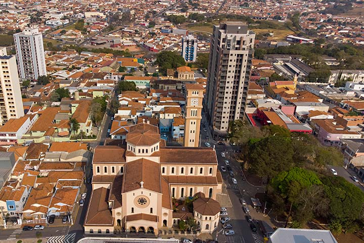
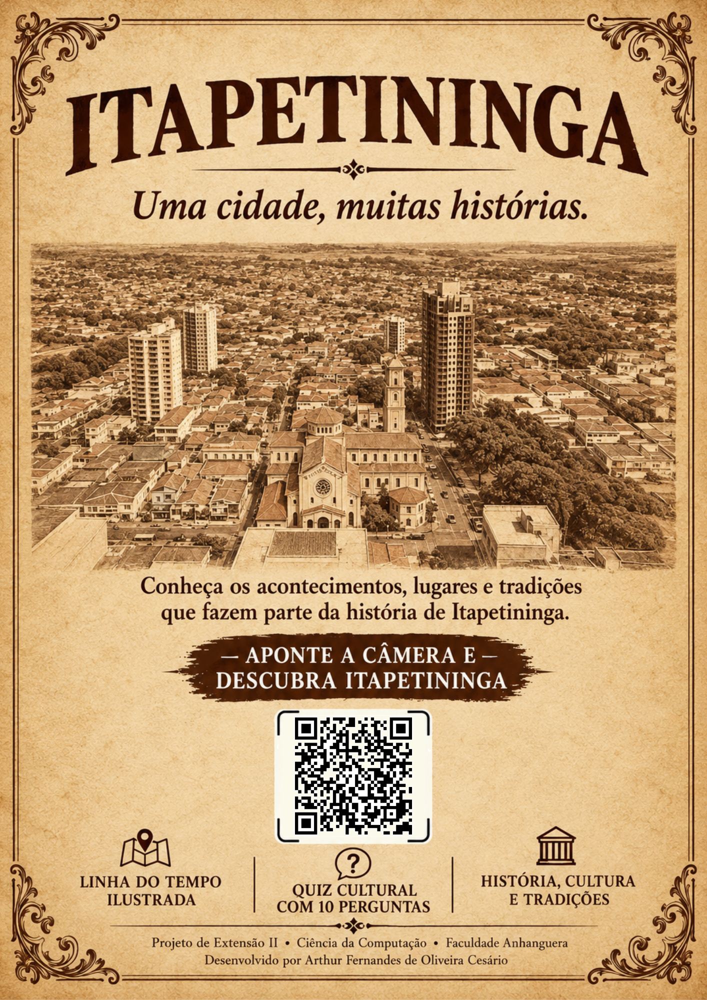

# Itapetininga, uma história em construção

Site educativo com linha do tempo ilustrada e quiz cultural sobre a história de Itapetininga (SP). Desenvolvido para o Projeto de Extensão II do curso de Ciência da Computação da Faculdade Anhanguera.

**Site publicado:** https://arthurfernandes97.github.io/historia-itapetininga


<p align="center">
  
</p>

---

## Sobre o projeto

O projeto faz parte do programa de **Ação e Difusão Cultural**, que propõe usar tecnologia para apoiar atividades culturais. Criei um site que apresenta a origem do nome da cidade, os principais marcos do início da sua formação e um quiz para fixar o conteúdo de forma interativa.

O acesso foi pensado para o público da cidade. Montei um cartaz com QR code que leva direto ao site e o deixei exposto em um espaço cultural de Itapetininga. O projeto foi avaliado com nota máxima.

<p align="center">
  
</p>

---

## Ação de extensão

- **Local:** Casa Kennedy, Centro Cultural Brasil Estados Unidos (Itapetininga, SP)
- **Período de exposição:** 6 a 18 de novembro de 2026
- **Formato:** cartaz impresso com QR code em display acrílico de mesa
- **Autorização:** declaração assinada pela responsável pelo espaço, com depoimento sobre a ação
- **Alcance:** 21 visualizações registradas pelo GoatCounter no período. O número inclui meus acessos de teste e não separa quem entrou pelo QR code, então é uma estimativa
- **Divulgação ao público:** o cartaz foi apresentado aos visitantes em eventos do local, como a 3ª FLAIL (feira literária) e o 2º Festival de Rock

<p align="center">
  
  
---

## Funcionalidades

- Capa com atalhos para a história e para o quiz
- Linha do tempo com 5 marcos históricos, da origem do nome até 1852/1855
- Quiz com 10 perguntas sobre cultura, personalidades e tradições locais
- Alternativas embaralhadas a cada pergunta
- Etapa de confirmação antes de revelar a resposta
- Feedback com imagem e explicação para cada pergunta
- Barra de progresso, pontuação final e botão para refazer
- Layout responsivo para celular e computador

---

## Tecnologias

- HTML5
- CSS3 (variáveis, Grid, Flexbox e media queries)
- JavaScript puro, sem frameworks
- Google Fonts (Cormorant Garamond e DM Sans)
- GitHub Pages para publicação
- GoatCounter, contador de acessos sem cookies, usado só para medir o alcance da ação

---

## Como executar

O projeto não precisa de instalação nem de build. Baixe o repositório e abra o `index.html` no navegador, ou use uma extensão como o Live Server do VS Code.

---

## Uso de IA

Usei IA como ferramenta de apoio. O código do site foi gerado com o Manus e as ilustrações foram geradas por IA. A direção e a entrega do projeto foram minhas. Defini o tema, o público e a estrutura do site, com linha do tempo e quiz de 10 perguntas. Pesquisei e conferi o conteúdo histórico nas fontes listadas abaixo. Publiquei o site no GitHub Pages, configurei o contador de acessos, gerei o QR code e preparei o cartaz impresso. Também apresentei o projeto à instituição, obtive a autorização e acompanhei os resultados da exposição.

---

## Estrutura do repositório

```
historia-itapetininga/
├── index.html
├── style.css
├── script.js
├── assets/        
├── docs/          
└── README.md
```

---

## Fontes de referência

- [Prefeitura de Itapetininga, História e Cultura](https://www.itapetininga.sp.gov.br/pagina/69/cultura/sub-pagina/75/)
- [Câmara Municipal de Itapetininga, História](https://www.camaraitapetininga.sp.gov.br/a-cidade/historia)
- [IBGE, Histórico de Itapetininga](https://cidades.ibge.gov.br/brasil/sp/itapetininga/historico)

---

## Autor

**Arthur Fernandes de Oliveira Cesário**

Estudante de Ciência da Computação, Faculdade Anhanguera

GitHub: [arthurfernandes97](https://github.com/arthurfernandes97)
